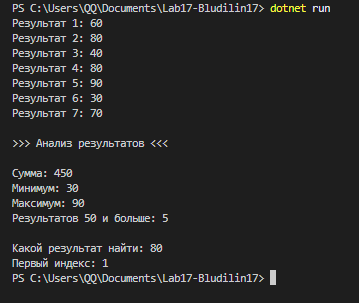

# Практическая работа №17

Автор: Блудилин Имя  
Группа: ИСП-255

## Тема

Алгоритмы обработки массивов.

## Что реализовано

- сумма элементов;
- подсчёт элементов по условию;
- минимум и максимум;
- линейный поиск;
- поиск первого индекса.

## Короткие ответы

1. Почему максимум нельзя всегда начинать с `0`?

Ответ: если в массиве одни отрицательные числа, то все они меньше нуля, и программа так и выдаст 0, хотя такого числа в массиве нет. Поэтому я беру за начало первый элемент массива и сравниваю с ним остальные.

2. Что означает `-1` после поиска индекса?

Ответ: это значит, что такого числа в массиве не нашлось. Индексы у нас начинаются с 0, то есть -1 быть индексом не может, поэтому его и используют для этого случая.

3. Чем сумма отличается от подсчёта элементов?

Ответ: в сумме мы прибавляем сами значения элементов, а при подсчёте просто прибавляем 1 каждый раз, когда элемент подходит под условие. Например, для сумм это `sum += number`, а для подсчёта `count++`.

## Результат

